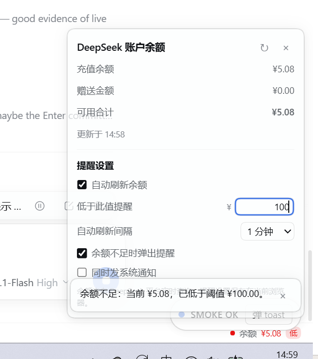

# dsh-balance-monitor

**Real-time DeepSeek account balance and low-balance alerts for the DeepSeek Harness Web GUI.**

[中文说明](README.zh-CN.md) · [MIT License](LICENSE)



## Features

- **Always-visible balance bar**: a slim status bar at the bottom of the DSH Web GUI shows `● Balance ¥x.xx`. It refreshes every 60 seconds by default, and again when the window regains focus or the page becomes visible.
- **Detail panel**: click the bar to see recharge balance, bonus credit, total available, and the last update time, plus a manual **Refresh now** button.
- **Low-balance alert**: set a threshold (default `¥5.00`). When the total available balance drops below it:
  - the bar turns red and shows a **Low** badge;
  - an in-app reminder appears (e.g. `Low balance: ¥4.19 left, below the ¥5.00 threshold.`);
  - optionally, an operating-system notification is sent too (browser notification permission required).
- **Settings**: threshold, auto-refresh interval (30 s / 1 / 5 / 10 minutes), reminder toggle, and system-notification toggle — available both in the bar's panel and under **Settings → Balance reminder**.
- **Persistent settings**: reminder preferences are stored in the browser (`localStorage`), so they survive page reloads and app restarts.
- **Bilingual UI**: follows the DSH interface language (English / Chinese built in).

## Requirements

- DeepSeek Harness desktop **0.2.2-rc.1** or a compatible release.
- Signed in with a **DeepSeek account**. The balance comes from account credits; API-key-only setups have no account balance to read.

## Install

### Option A — let a DSH agent install it (recommended, no restart)

In any DSH session, ask the agent to install this plugin, or call the tool directly:

```
plugin_manager install_bundle  target = github:kousenlee/dsh-balance-monitor
```

A result with `application: applied` means the plugin is live in the running GUI immediately.

### Option B — CLI, then restart the app

```powershell
# For the desktop app, the CLI lives next to the executable:
#   <DSH install>\resources\runtime\cli\bin\dsh.cmd
dsh plugin --profile desktop add github:kousenlee/dsh-balance-monitor
```

Then add `"dsh-balance-monitor"` to `dsh.profile.bundles` in
`<DSH_HOME>/profiles/<profile>/package.json` (default `%USERPROFILE%\.dsh`) and restart DeepSeek Harness.
`install.ps1` automates this option.

### Option C — from a clone (local development)

```powershell
git clone https://github.com/kousenlee/dsh-balance-monitor.git
cd dsh-balance-monitor
powershell -ExecutionPolicy Bypass -File install.ps1
```

`install.ps1` auto-detects the DSH installation, home directory and profile. Override with
`-Profile`, `-DshExe`, `-DshHome`, `-Spec`, `-Restart`. Run it from the repo root, or pass a remote spec:

```powershell
powershell -ExecutionPolicy Bypass -File install.ps1 -Spec github:kousenlee/dsh-balance-monitor
```

> `install.ps1` / `uninstall.ps1` are Windows PowerShell helpers. On macOS or Linux, use Option A (DSH agent) or Option B (CLI); the plugin itself is cross-platform.

## Usage

1. The bottom status bar shows `● Balance ¥x.xx` in every view:
   - green dot — read OK;
   - amber dot — the last refresh failed and the previous value is shown;
   - red dot + **Low** badge — total available is below your threshold.
2. Click the bar to open the panel:
   - top: recharge balance / bonus credit / total available / last updated time;
   - bottom: **Reminder settings** — threshold, auto-refresh interval, reminder toggles.
3. Edit the threshold and press Enter (or click elsewhere). If the balance is already below the new threshold, a reminder appears once; further reminders for the same low period are spaced at least 30 minutes apart.
4. The same controls are also available from **Settings → Balance reminder**.

## Data and privacy

- The balance is read through DSH's own account capability (`ctx.remote.account.getBalance(...)`); the DSH Host queries the DeepSeek Platform and returns only wallet amounts. **This plugin never sees, stores, or transmits your login token.**
- Amounts are displayed from the platform's original decimal strings (two decimal places, digit grouping, `<¥0.01` handling) without floating-point rounding.
- Reminder preferences are written only to the current browser's `localStorage`.

## Display rules

- **Total available = recharge balance + bonus credit** for the same currency. DeepSeek charges bonus credit first; the recharge wallet is consumed after the bonus runs out.
- Currencies (CNY / USD) are never converted or summed across currencies; the panel shows the selected currency and lets you switch when the data contains more than one.
- A failed read never becomes a zero balance: the previous successful value stays visible with a stale indicator.

## Scope and limitations

- Account-login balances only; API-key installs have no account balance to display (the bar shows "signed out").
- Reminders require the GUI page to be open; nothing alerts while the app is closed.
- Polling is no faster than 30 seconds; the platform has no client-side cache.
- The balance is read live and is continuously consumed by model usage, so it can differ slightly from usage statistics shown elsewhere in DSH.
- Non-owner shared views (e.g. LiveShare viewers) lack the account remote grant, so the bar is not mounted for them.
- Settings are per browser profile, not synchronized across devices.

## Uninstall

Remove it live through a DSH agent:

```
plugin_manager remove_bundle  target = dsh-balance-monitor
```

Or run `uninstall.ps1` and restart the app. The profile's bundle list and package dependency are restored.

## Project layout

```
dsh-balance-monitor/
├─ package.json          # bundle + client manifest (dsh.bundle.patch, dsh.client.platform)
├─ cordis.patch.yml      # bundle layer: inserts the balance-monitor Loader row
├─ lib/
│  ├─ index.js           # Host half (no-op; makes the package a Loader row)
│  └─ client.js          # Browser half (hand-written __ModuleLoader__ bundle with all UI)
├─ docs/panel-and-alert.png
├─ install.ps1
├─ uninstall.ps1
├─ README.md
├─ README.zh-CN.md
└─ LICENSE
```

## Development notes

- The browser half is a hand-written CommonJS bundle: `window.__ModuleLoader__.load({ id, factory })`. Inside the factory only platform-baseline modules (`react`, `react-dom`) may be required; no `import`/`export`/JSX is allowed in that file.
- The always-visible bar registers in the `shell.bottom` slot; the settings page registers in `settings.section`. Both registrations are gated by `ctx.remoteAccess.whenAccess("account/watch", …)`, so shared non-owner views never see a balance surface.
- Styles are injected once as a `<style data-plugin-css>` tag and use DSH's `--dsw-*` design tokens, so the UI follows the active theme.
- After installation, editing `lib/client.js` reloads the client bundle through HMR; changing `package.json` or the Host half needs a reinstall/restart.

## License

[MIT](LICENSE) © 2026 kousenlee
