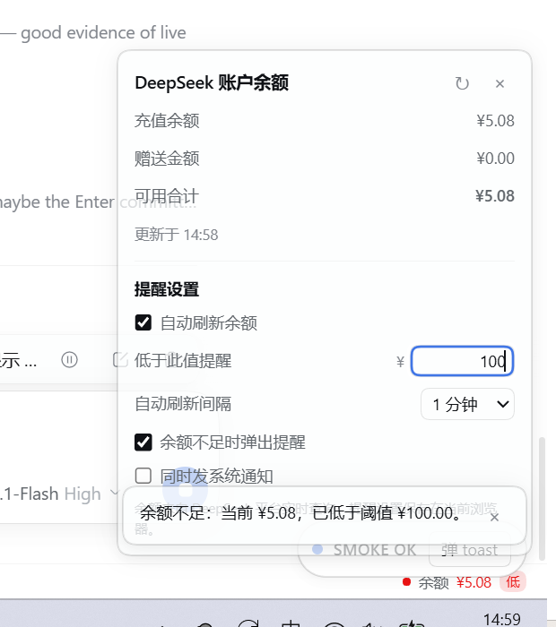

# dsh-balance-monitor

**在 DeepSeek Harness Web GUI 中实时显示 DeepSeek 账户余额，并在余额不足时提醒。**

[English README](README.md) · [MIT 许可证](LICENSE)



## 功能

- **常驻余额栏**：DSH Web GUI 底部固定显示 `● 余额 ¥x.xx`，默认每 60 秒刷新一次；窗口重新聚焦或页面重新可见时也会刷新。
- **明细面板**：点击余额栏打开面板，显示充值余额、赠送金额、可用合计与最近更新时间，并提供「立即刷新」。
- **低余额提醒**：可设置阈值（默认 `¥5.00`）。可用合计低于阈值时：
  - 余额栏变红并显示「低」徽标；
  - 弹出提醒（例如「余额不足：当前 ¥4.19，已低于阈值 ¥5.00。」）；
  - 可选同时发送系统通知（需要浏览器通知权限）。
- **提醒设置**：阈值、自动刷新开关与间隔（30 秒 / 1 / 5 / 10 分钟）、提醒开关、系统通知开关；面板内和 **设置 → 余额提醒** 分区均可修改。
- **设置持久化**：提醒设置保存在当前浏览器（`localStorage`），刷新页面、重启应用后仍生效。
- **中英双语**：跟随 DSH 界面语言。

## 环境要求

- DeepSeek Harness 桌面版 **0.2.2-rc.1** 或兼容版本。
- 使用 **DeepSeek 账户登录**。余额来自账户余额（充值 + 赠送）；仅配置 API Key 的用法没有账户余额可读。

## 安装

### 方式一 — 让 DSH 智能体安装（推荐，无需重启）

在任意 DSH 会话里让智能体安装本插件，或直接调用工具：

```
plugin_manager install_bundle  target = github:kousenlee/dsh-balance-monitor
```

返回 `application: applied` 即表示已在运行中的 GUI 里生效。

### 方式二 — 命令行安装，然后重启应用

```powershell
# 桌面版的 dsh CLI 位于应用目录下：
#   <DSH 安装目录>\resources\runtime\cli\bin\dsh.cmd
dsh plugin --profile desktop add github:kousenlee/dsh-balance-monitor
```

然后把 `"dsh-balance-monitor"` 追加到 profile 的 `dsh.profile.bundles`：
`<DSH_HOME>/profiles/<profile>/package.json`（默认 `%USERPROFILE%\.dsh`），再重启 DeepSeek Harness。
`install.ps1` 会自动完成这些步骤。

### 方式三 — 从仓库克隆后本地安装（开发用）

```powershell
git clone https://github.com/kousenlee/dsh-balance-monitor.git
cd dsh-balance-monitor
powershell -ExecutionPolicy Bypass -File install.ps1
```

`install.ps1` 会自动探测 DSH 安装目录、DSH_HOME 与 profile；可用 `-Profile`、`-DshExe`、`-DshHome`、`-Spec`、`-Restart` 覆盖。
也可以不克隆，直接指定远程源安装：

```powershell
powershell -ExecutionPolicy Bypass -File install.ps1 -Spec github:kousenlee/dsh-balance-monitor
```

> `install.ps1` / `uninstall.ps1` 是 Windows PowerShell 辅助脚本。macOS / Linux 上请使用方式一（DSH 智能体）或方式二（CLI）；插件本体跨平台可用。

## 使用

1. 底部状态栏在任意界面显示 `● 余额 ¥x.xx`：
   - 绿点：读取正常；
   - 橙点：上次刷新失败，显示的是上次成功值；
   - 红点 + 「低」徽标：可用合计低于你设置的阈值。
2. 点击余额栏打开面板：
   - 上半部分：充值余额 / 赠送金额 / 可用合计 / 更新时间；
   - 下半部分「提醒设置」：阈值、刷新间隔与提醒开关。
3. 修改阈值后按回车（或点击别处）生效。如果当前余额已低于新阈值，会立即提醒一次；同一段低余额期间，后续提醒间隔至少 30 分钟。
4. 相同设置也可从 **设置 → 余额提醒** 进入。

## 数据与隐私

- 余额通过 DSH 官方账户能力读取：客户端调用 `ctx.remote.account.getBalance(...)`，由 DSH Host 向 DeepSeek 平台查询并只返回钱包金额。**本插件不会看到、保存或传输你的登录 token。**
- 金额按平台返回的原始十进制字符串显示（两位小数、千分位、`<¥0.01` 处理），不做浮点四舍五入。
- 提醒设置只写入当前浏览器的 `localStorage`，不上传。

## 显示口径

- **可用合计 = 充值余额 + 赠送金额**（同一币种）。DeepSeek 扣费优先消耗赠送金额，赠送用完后扣减充值余额。
- 不同币种（CNY / USD）不换算、不跨币种相加；面板按所选币种显示，数据包含多币种时可切换。
- 读取失败不会变成 0 余额：保留上次成功值并显示「上次刷新失败」提示。

## 已知限制

- 仅支持账户登录的余额；仅用 API Key 的安装没有账户余额可显示（余额栏显示「未登录」）。
- 提醒要求 GUI 页面处于打开状态；应用关闭期间不会提醒。
- 轮询间隔最快 30 秒，平台侧没有客户端缓存。
- 余额是实时读取值，且会被模型调用持续扣费，因此可能与 DSH 内其它用量统计存在细微差异。
- 非 owner 的共享视图（如 LiveShare viewer）没有账户远程授权，不会显示余额栏。
- 提醒设置按浏览器保存，不跨设备同步。

## 卸载

让 DSH 智能体热卸载：

```
plugin_manager remove_bundle  target = dsh-balance-monitor
```

或运行 `uninstall.ps1` 后重启应用。profile 的 bundle 列表与包依赖都会恢复原状。

## 目录结构

```
dsh-balance-monitor/
├─ package.json          # bundle + client 清单（dsh.bundle.patch、dsh.client.platform）
├─ cordis.patch.yml      # bundle 层：插入 balance-monitor Loader 行
├─ lib/
│  ├─ index.js           # Host 半边（no-op，仅让包成为一条 Loader 行）
│  └─ client.js          # 浏览器半边（手写 __ModuleLoader__ bundle，包含全部 UI）
├─ docs/panel-and-alert.png
├─ install.ps1
├─ uninstall.ps1
├─ README.md
├─ README.zh-CN.md
└─ LICENSE
```

## 开发说明

- 浏览器半边是手写 CommonJS bundle：`window.__ModuleLoader__.load({ id, factory })`。`factory` 内只能 require 平台基线模块（`react`、`react-dom`），文件中不能出现 `import`/`export`/JSX。
- 常驻余额栏注册在 `shell.bottom` 槽位；设置页注册在 `settings.section`。两者都在 `ctx.remoteAccess.whenAccess("account/watch", …)` 内注册，因此非 owner 的共享视图不会出现余额面。
- 样式以 `<style data-plugin-css>` 一次性注入，并使用 DSH 的 `--dsw-*` 设计 token，跟随主题。
- 安装后修改 `lib/client.js` 会由客户端 HMR 重新加载；修改 `package.json` 或 Host 半边需要重新安装/重启。

## 许可证

[MIT](LICENSE) © 2026 kousenlee
